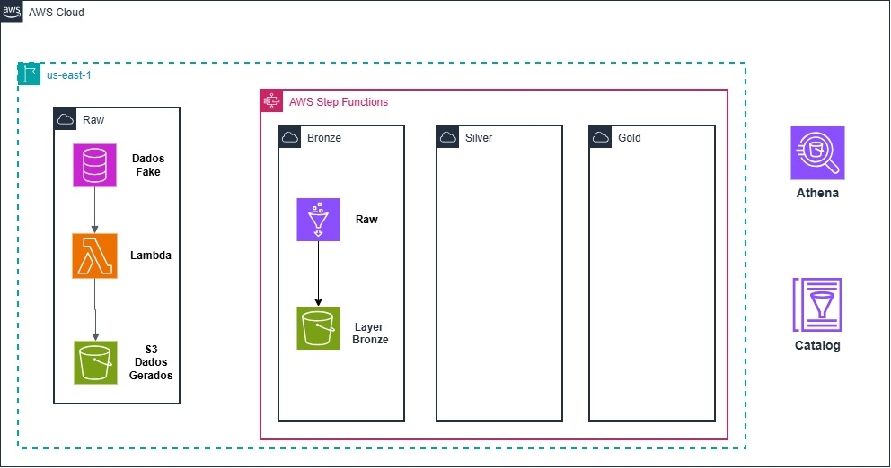

# Pipeline de Dados Contábeis na AWS

**Geração de dados sintéticos e ingestão na camada Bronze com AWS**

---

## Sobre o projeto

Protótipo de pipeline para gerar transações sintéticas em Parquet e carregá-las na camada Bronze usando AWS Lambda, AWS Step Functions e AWS Glue.

**Escopo atual:** geração dos dados e ingestão Bronze. As camadas Silver e Gold e as validações completas de qualidade de dados não fazem parte da implementação atual.

## Arquitetura

 

### Fluxo de execução

EventBridge Scheduler
        ↓
Step Functions — sf-aws-desafio
        ↓
Lambda — gerador-parquet-contratos
        ↓
S3 — arquivos Parquet de entrada
        ↓
AWS Glue — glue-job-aws
        ↓
S3 / Glue Data Catalog — camada Bronze em Iceberg V3

O agendamento está configurado para três execuções diárias, às **09:00, 13:00 e 23:00**, no fuso `America/Sao_Paulo`. A Step Functions aguarda a geração dos arquivos pela Lambda antes de iniciar o job do Glue.

## Componentes

| Componente | Responsabilidade |
|---|---|
| `gerador-parquet-contratos` | Gera dados sintéticos e arquivos Parquet de entrada. |
| `sf-aws-desafio` | Orquestra a Lambda geradora e o job do Glue. |
| `glue-job-aws` | Lê os Parquet e grava os dados na camada Bronze. |
| EventBridge Scheduler | Inicia a máquina de estados três vezes ao dia. |

## Contrato e qualidade de dados

O contrato de referência inclui identificadores de transação, contrato, conta e agência; tipo de contrato e lançamento; valor; datas de lançamento e processamento; código COSIF; indicador de estorno e identificador do lote.

As seguintes regras precisam ser validadas antes de considerar a camada Bronze completa:

- Campos obrigatórios preenchidos.
- `id_transacao` único.
- `valor_lancamento > 0`.
- `dt_lancamento <= dt_processamento`.
- `cod_cosif` existente no domínio COSIF.

A intenção é preservar os dados de origem e registrar ou encaminhar os registros inválidos, sem descartá-los silenciosamente.

## Testes locais

Com Python e as dependências do projeto instaladas:

python -m venv .venv
pip install -r requirements.txt
python -m pytest app/tests -q

## Configuração AWS

O ambiente atual utiliza a região `us-east-1`. Buckets, caminhos S3, banco e tabela do Glue Data Catalog devem ser configurados conforme o ambiente; não inclua credenciais ou chaves no código.

A execução manual ponta a ponta foi validada. A primeira execução automática do cronograma deve ser acompanhada no EventBridge e no histórico de execuções da Step Functions.

## Próximas etapas

- Implementar e testar as regras de qualidade de dados.
- Registrar métricas de registros aceitos e rejeitados.
- Avaliar reprocessamento idempotente e ingestão incremental.
- Desenvolver as camadas Silver e Gold.
- Medir desempenho com volumes representativos antes de afirmar capacidade de produção.

## Segurança

Os arquivos de entrada devem conter somente dados sintéticos. Não publique dados pessoais ou regulatórios, credenciais, arquivos `.env` ou o PDF confidencial do desafio.

## Consulta da tabela Bronze no Athena

A tabela `desafio_glue.fin_contabilidade_saldo_contrato_bronze` foi criada em Iceberg V3. No ambiente utilizado, o Athena retornou `Cannot read unsupported version 3` ao tentar consultá-la.

Para permitir a exploração dos dados pelo Athena, foi criada a tabela auxiliar `desafio_glue.fin_contabilidade_saldo_contrato_bronze_alt`, em Iceberg V2, por meio de um job AWS Glue/Spark. A cópia foi gravada em:

`s3://mockdesafio-iceberg/athena-alt/fin_contabilidade_saldo_contrato_bronze_alt/`

A tabela `_alt` serve apenas para consulta no Athena e não substitui a tabela Bronze original em V3. Como é uma cópia, deve ser recriada ou atualizada quando os dados da tabela original mudarem.

## Arquitetura e decisões técnicas

O projeto implementa um pipeline batch com organização Medallion. O escopo atual cobre a geração dos dados sintéticos e a ingestão na camada Bronze; Silver e Gold são etapas futuras.

A orquestração segue esta sequência:

1. O EventBridge Scheduler inicia a máquina de estados três vezes ao dia.
2. A Step Functions invoca a Lambda geradora.
3. A Lambda cria dados sintéticos e os disponibiliza em Parquet no S3.
4. A Step Functions inicia o job do AWS Glue e aguarda sua conclusão.
5. O Glue processa os arquivos com Spark e grava a camada Bronze em Iceberg.

A separação entre geração e processamento permite testar o produtor e o job de ingestão de forma independente. A Step Functions controla a ordem das etapas e apresenta o estado da execução.

## Serviços e ferramentas

| Serviço/ferramenta | Uso no projeto |
|---|---|
| Amazon EventBridge Scheduler | Dispara o fluxo em horários programados. |
| AWS Step Functions | Orquestra a Lambda geradora e o job Glue em sequência. |
| AWS Lambda | Gera dados sintéticos para testes. |
| Amazon S3 | Armazena os arquivos Parquet de entrada e os dados da camada Bronze. |
| AWS Glue | Executa o processamento Spark e gerencia o job de ingestão. |
| AWS Glue Data Catalog | Mantém os metadados das tabelas, conforme configuração do ambiente. |
| Apache Iceberg | Formato de tabela usado na camada Bronze. |
| Terraform | Define infraestrutura nos arquivos presentes em `infra/`. |
| Pytest | Executa os testes automatizados do projeto. |

## Percurso pelo código

| Arquivo/componente | Responsabilidade |
|---|---|
| `app/src/data_generator/data_factory.py` | Lógica de criação dos dados sintéticos. |
| `app/lambda_function.py` | Ponto de entrada da função Lambda, se esse for o handler configurado no deploy. |
| Definição da Step Functions | Define a sequência Lambda → Glue e o tratamento do resultado de cada etapa. |
| Script do AWS Glue | Lê os Parquet do S3 e grava os dados na camada Bronze. |
| `infra/main.tf` e `infra/variables.tf` | Definem recursos e parâmetros de infraestrutura presentes no Terraform. |
| `app/tests/` | Testes automatizados da lógica de geração e de seus componentes. |

## Terraform
| Criação do Terraform para criação e destruição da arquitetura. |

## Contrato e qualidade dos dados

As regras previstas para o contrato incluem:

- Campos obrigatórios preenchidos.
- `id_transacao` único.
- `valor_lancamento > 0`.
- `dt_lancamento <= dt_processamento`.
- `cod_cosif` existente no domínio de referência.

> Informe nesta seção quais regras já estão implementadas e quais ainda estão pendentes. Não descreva uma validação como concluída antes de testá-la.

## Limitações conhecidas

A execução de teste com uma amostra pequena valida o fluxo funcional, mas não demonstra capacidade para processar centenas de milhões de transações dentro do SLA do desafio. A capacidade e o custo precisam ser avaliados com testes de volume representativos.

## Próximas etapas

- Implementar e testar as regras de qualidade de dados.
- Registrar métricas de registros válidos e rejeitados.
- Definir e testar a estratégia de reprocessamento idempotente.
- Avaliar particionamento e otimizações Spark.
- Desenvolver as camadas Silver e Gold.
- Medir desempenho com volumes representativos.
